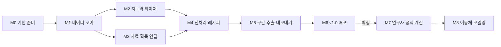

# Askos 로드맵

> 진행 상황은 **📍 개발 현황판 (#1)** 에서 자동으로 갱신됩니다.
> 이 문서는 **단계의 정의와 순서**를, 현황판은 **지금 어디까지 왔는지**를 다룹니다.

## 이 문서를 쓰는 법

- 새로운 기능을 요청하기 전에, 그 기능이 **어느 단계에 속하는지** 아래 표에서 먼저 찾아보세요.
- 그 단계의 **선행 단계가 끝나지 않았다면** 지금 구현을 요청하지 말고 아이디어 양식으로 남겨 두세요. 해당 단계의 보류 작업으로 등록됩니다.
- 순서를 바꿔야 할 분명한 이유가 있다면 최종 결정자가 승인하고 `순서예외` 라벨로 기록합니다.

## 왜 이 순서인가

모든 기능은 결국 "시각 t, 위치 (위도, 경도)에서 이 값은 얼마인가"를 묻는 하나의 데이터 코어 위에 올라갑니다.
그래서 **데이터 코어를 먼저 단단히 만들고**, 그 위에 눈으로 확인하는 화면(지도)을, 그다음에 자료를 가져오는 통로(커넥터),
자료를 다듬는 도구(전처리), 자료를 내보내는 도구(추출) 순으로 쌓습니다.
뒤 단계 기능을 먼저 만들면 코어가 바뀔 때마다 다시 고쳐야 합니다.

M2와 M3는 M1이 끝나면 **함께 진행해도 됩니다.** 그 외에는 화살표 순서를 따릅니다.

## v1.0 단계 (진행률 계산 대상)

| 단계 | 가중치 | 목표 | 선행 |
|---|---|---|---|
| **M0 기반 준비** | 10% | 개발 골격을 세우고, 설계를 좌우할 사실(서버·자료 형식)을 실험으로 확인한다 | 없음 |
| **M1 데이터 코어** | 20% | 어떤 자료든 하나의 내부 형태로 읽고, 시공간 위치의 값을 물을 수 있다 (화면 없이 테스트로 검증) | M0 |
| **M2 지도와 레이어** | 25% | 해도 위에 환경장과 외부 계산 궤적을 시간에 맞춰 겹쳐 재생한다 | M1 |
| **M3 자료 획득 연결** | 13% | 프로그램 안에서 원하는 범위의 자료를 받아 카탈로그에 쌓는다 | M1 |
| **M4 전처리 레시피** | 8% | 원본을 보존한 채 품질 검사·이상값 처리·보간을 단계로 적용하고 재현한다 | M2, M3 |
| **M5 구간 추출·내보내기** | 15% | 원하는 시간·영역, 또는 궤적을 따라 자료를 원하는 구조와 형식으로 내보낸다 | M4 |
| **M6 v1.0 배포** | 9% | 연구자 PC에 설치해 서남해 시나리오를 처음부터 끝까지 수행한다 | M5 |

궤적 재생은 별도 단계 없이 M2(재생)와 M5(궤적을 따라 추출)에 들어 있습니다 (결정 0001).
**M2가 끝나면 첫 사용 연구자가 자기 계산 결과를 해도·조류 위에서 재생해 볼 수 있습니다.**

### M0 기반 준비

- [결정] 앱 형태와 UI 기술 스택 결정
- ~~[결정] 궤적 재생을 v1에 포함할지 결정~~ → 포함으로 결정 (#3)
- [실험] NOSC OPeNDAP 서버 확인 (GOCI-II 표층해류 위치·파일명·변수, 슬롯 영역, 위경도 자료, 시각 기준, 부분 요청)
- [실험] Copernicus Marine Toolbox 서남해 부분 다운로드 시험
- [실험] 기상청·국립해양조사원 API 응답 형식 확인
- [구현] 프로젝트 골격 (패키지 구조, 의존성 관리, 테스트·린트 CI)
- [결정] 첫 사용 사례 입력 자료 목록 확정 (연구자 출력 샘플, 해도 파일 형식) → 결정 0006

**끝났다는 기준:** 기술 스택 결정 문서가 병합되었고, 실험 결과가 `docs/experiments/`에 기록되었으며, CI가 빈 테스트로 통과한다.

### M1 데이터 코어

- 공통 데이터 모델 정의: 격자장·관측점·궤적, 메타데이터(단위·좌표계·시각·출처)
- 규약 통일 계층: 벡터는 u/v로 저장, 방향 규약 변환, 단위 변환, 시각 UTC
- 시공간 질의 인터페이스: 값 조회와 보간(최근접·쌍선형·시간 선형)
- 파일 어댑터: NetCDF(CF 규약), GRIB
- 파일 어댑터: CSV 관측점·궤적 (열 매핑 설정 포함, 연구자 계산 결과 형식 포함)
- 로컬 카탈로그: 자료 목록·출처·요청 범위 기록, 오프라인 동작

**끝났다는 기준:** 샘플 NetCDF 해류 자료와 CSV 궤적을 읽어, 궤적 각 시점의 해류값을 뽑는 테스트가 통과한다.

### M2 지도와 레이어

- 앱 기본 화면 골격 (M0에서 정한 기술 스택)
- 배경 지도: 오픈소스 해안선 기본 + 보유 해도 파일 불러오기
- 벡터장 레이어: 화살표·유선·색상
- 스칼라장 레이어: 색상 지도와 범례
- 시간 축: 시간 슬라이더, 재생, 레이어 간 시각 동기화
- 레이어 패널: 켜기/끄기, 순서, 투명도, 표출 설정 저장
- 궤적 레이어: 외부 계산 결과 불러오기·재생 (실측은 선, 시뮬레이션은 입자 구름)
- [결정] 연구자 실제 출력 형식 확인과 임시 샘플 교체 (#53, 궤적 레이어를 끝내기 전)

**끝났다는 기준:** 로컬 파일 두 종류 이상(예: 해류·바람)을 한 지도에 겹쳐 시간 재생할 수 있고,
첫 사용 연구자의 계산 결과 궤적을 그 위에 같은 시각으로 맞춰 재생할 수 있다.

### M3 자료 획득 연결

- [결정] 파랑 자료 출처와 필요한 변수
- 커넥터 공통 규격
- NOSC OPeNDAP 커넥터 (부분 요청 + 통째 받기)
- Copernicus Marine 커넥터 (계정 로그인 포함)
- 국내 API 커넥터 (기상청·국립해양조사원)
- 다운로드 화면: 출처·변수·범위 선택, 진행 표시, 재시도

**끝났다는 기준:** 서남해 3일치 해류·바람을 프로그램 안에서 받아 바로 지도에 띄우고, 인터넷 없이 다시 열어도 카탈로그에서 불러올 수 있다.

### M4 전처리 레시피

- 레시피 구조: 단계 블록, 원본 불변, 이력 기록·재적용
- 품질 검사: 물리적 범위·급변·중복 시각·육지 위 지점
- 이상값 처리·보간·리샘플링 단계
- 원본/처리본 전환과 이상 지점 표시

**끝났다는 기준:** 저장한 레시피를 다른 자료에 그대로 적용해 같은 결과를 재현한다.

### M5 구간 추출·내보내기

- 시간·영역 선택 (지도에서 그리기)
- 내보내기 형식: CSV, NetCDF(CF), MAT
- 자료 구조 템플릿: 열 선택·이름·단위·시간 표기·행 구조, 저장·재사용
- 처리 이력·출처 메타데이터 첨부
- 궤적을 따라 환경값 추출 (궤적 각 시점의 바람·조류 등과 매칭 품질 정보)

**끝났다는 기준:** 연구자가 지정한 구간 또는 궤적을 따라 뽑은 자료를 원하는 형식으로 받아, 추가 가공 없이 MATLAB에서 바로 읽는다.

### M6 v1.0 배포

- 독립 실행 앱 패키징
- 사용 설명서와 예제 데이터
- 크레딧(출처) 화면
- 첫 사용 연구자 시험 사용과 피드백 반영

**끝났다는 기준:** 연구자 PC에 설치해 서남해 시나리오(자료 받기 → 겹쳐 보기 → 전처리 → 내보내기)를 처음부터 끝까지 수행한다.

## 확장 단계 (v1.0 이후, 진행률에 포함하지 않음)

| 단계 | 내용 | 선행 |
|---|---|---|
| **M7 연구자 공식 계산** | 연구자가 등록한 공식으로 프로그램 안에서 표류를 계산·시각화·추출 | M6 |
| **M8 이동체 모델링** | 크기·무게·밀도·풍압면·형상으로 이동체를 만들거나 불러와 궤적 계산 | M7 |

확장 단계의 기능을 지금 요청하면, 구현하지 않고 해당 단계의 `보류` 작업으로 등록합니다.
다만 **데이터 코어(M1)는 처음부터 궤적 타입과 이동체 파라미터 자리를 갖도록** 설계해, 확장 시 코어를 다시 고치지 않게 합니다.

## 진행률 계산 방식

- 단계 진행률 = 그 단계에서 닫힌 작업의 크기 합 ÷ 전체 작업의 크기 합
- 작업 크기: `크기:S` = 1, `크기:M` = 2 (라벨 없으면 M), `크기:L` = 4
- 전체 진행률 = 각 단계 진행률 × 단계 가중치의 합 (v1.0 단계만)
- "계획 안 함"으로 닫은 작업은 계산에서 빠집니다
- 작업이 새로 추가되면 진행률이 내려갈 수 있습니다. 이는 계획이 구체화된 것이므로 정상입니다
